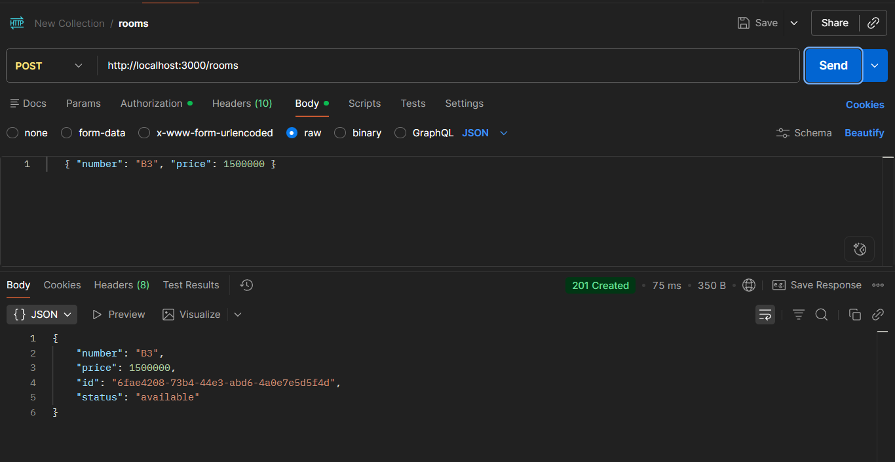
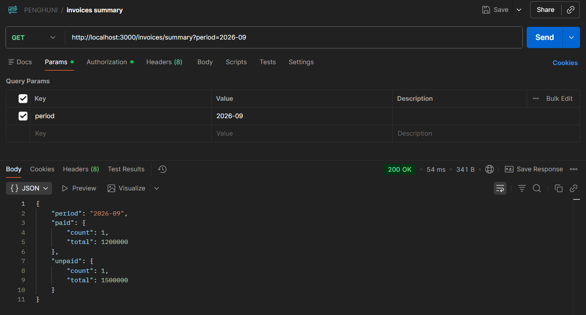

# KosKu API
 
[](https://github.com/naufalraism/kosku-api/actions/workflows/ci.yml)
 
Backend for a boarding-house (kost) management system: admin login, rooms, tenants, and monthly invoices with payment tracking and overdue reporting.
 
Frontend: [kosku-web](https://github.com/naufalraism/kosku-web) · [Live frontend demo](https://kosku-web.naufal-majid.workers.dev) (runs on sample data in the browser; this API is not hosted online, see [Deployment notes](#deployment-notes)).
 
## Tech stack
 
NestJS 12, TypeScript, TypeORM, PostgreSQL, JWT auth (Passport), class-validator, Jest, Docker, GitHub Actions.
 
## Features
 
- Admin login with JWT (the first admin can be registered once, then registration closes)
- Rooms CRUD with unique room numbers
- Tenants CRUD; assigning a room marks it occupied, changing or removing it frees the old room
- Invoices: generate per month (idempotent), mark as paid, list with filters, overdue list, monthly summary
- Input validation, a health check endpoint, and CORS restricted through configuration
## Screenshots
 
<p align="center">
  
  
</p>
## Run locally
 
```bash
cp .env.example .env        # on Windows PowerShell: Copy-Item .env.example .env
# set a real JWT_SECRET in .env, for example:
# node -e "console.log(require('crypto').randomBytes(48).toString('hex'))"
docker compose up -d        # starts PostgreSQL
npm install
npm run start:dev           # http://localhost:3000
```
 
## Environment variables
 
| Variable | Purpose |
|---|---|
| `PORT` | HTTP port (default 3000) |
| `DB_HOST`, `DB_PORT`, `DB_USER`, `DB_PASSWORD`, `DB_NAME` | Local PostgreSQL connection |
| `DATABASE_URL` | Hosted PostgreSQL connection string (uses SSL); when set it replaces the `DB_*` variables |
| `DB_SYNCHRONIZE` | `true` auto-creates tables. Development or a first run only; defaults to `false` |
| `CORS_ORIGINS` | Allowed frontend URLs, comma-separated. When unset, all origins are allowed |
| `JWT_SECRET` | Secret used to sign tokens (required) |
| `JWT_EXPIRES_IN` | Token lifetime, for example `1d` |
 
## API
 
All routes except `/auth/*` and `/health` require `Authorization: Bearer <token>`.
 
| Method | Route | Description |
|---|---|---|
| GET | `/health` | Liveness check |
| POST | `/auth/register` | Create the first admin (only works once) |
| POST | `/auth/login` | Returns `{ accessToken }` |
| GET, POST | `/rooms` | List / create rooms |
| GET, PATCH, DELETE | `/rooms/:id` | Read / update / delete a room |
| GET, POST | `/tenants` | List / create tenants |
| GET, PATCH, DELETE | `/tenants/:id` | Read / update / delete a tenant |
| POST | `/invoices/generate` | Generate invoices for a month: `{ "period": "2026-10" }` |
| GET | `/invoices` | List invoices, optional `?period=2026-10&status=unpaid` |
| GET | `/invoices/overdue` | Unpaid invoices past their due date |
| GET | `/invoices/summary` | Totals for a month: `?period=2026-10` |
| GET | `/invoices/:id` | Read one invoice |
| PATCH | `/invoices/:id/pay` | Mark an invoice as paid |
 
## Try it
 
These commands are for a bash shell (on Windows use Git Bash, or send the same requests from Postman).
 
```bash
curl -X POST localhost:3000/auth/register -H 'Content-Type: application/json' \
  -d '{"email":"admin@example.com","password":"use-a-strong-password"}'
 
TOKEN=$(curl -s -X POST localhost:3000/auth/login -H 'Content-Type: application/json' \
  -d '{"email":"admin@example.com","password":"use-a-strong-password"}' | sed -E 's/.*"accessToken":"([^"]+)".*/\1/')
 
curl -X POST localhost:3000/rooms -H "Authorization: Bearer $TOKEN" -H 'Content-Type: application/json' \
  -d '{"number":"A1","price":1500000}'
```
 
## Tests
 
```bash
npm test
```
 
Unit tests cover invoice generation and payment rules (Jest + ts-jest). The test script runs Jest with `--experimental-vm-modules` so it can load NestJS 12's ES-module packages.
 
## Docker
 
```bash
docker build -t kosku-api .
docker run --rm -p 3001:3000 --env-file .env -e DB_HOST=host.docker.internal kosku-api
```
 
The image uses a multi-stage build and runs as a non-root user.
 
## CI
 
GitHub Actions runs on every pull request and push to `main`: install without lifecycle scripts, build, unit tests, `npm audit` on production dependencies, and a Docker image build.
 
## Deployment notes
 
- `synchronize` is off by default because it can alter or drop tables. Use `DB_SYNCHRONIZE=true` only for a first run against an empty database. Migrations are planned.
- Hosted databases need SSL: set `DATABASE_URL`, and set `CORS_ORIGINS` to the frontend URL in production.
- The API is not hosted online at the moment: the free tiers I looked at either require a payment card for verification or have strict limits. The public frontend demo therefore runs on in-browser sample data.
- Use dummy data only in any public demo.
## Roadmap
 
- [x] Auth, rooms, tenants
- [x] Invoices (monthly generation, paid/unpaid, overdue, summary) and unit tests
- [x] React + TypeScript frontend ([kosku-web](https://github.com/naufalraism/kosku-web))
- [x] Dockerfile and CI
- [ ] Database migrations instead of `synchronize`
- [ ] Hosted API (optional, needs a free tier that works without a payment card)